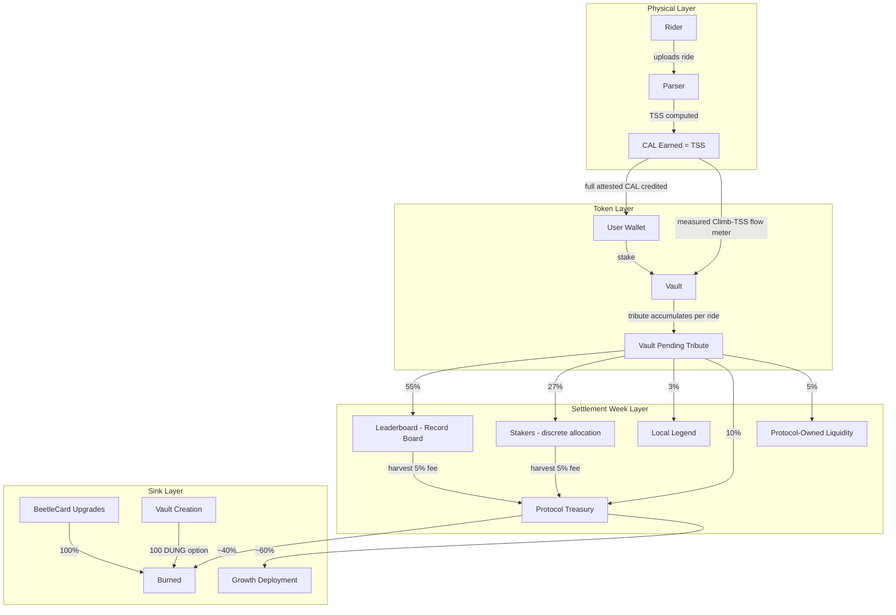
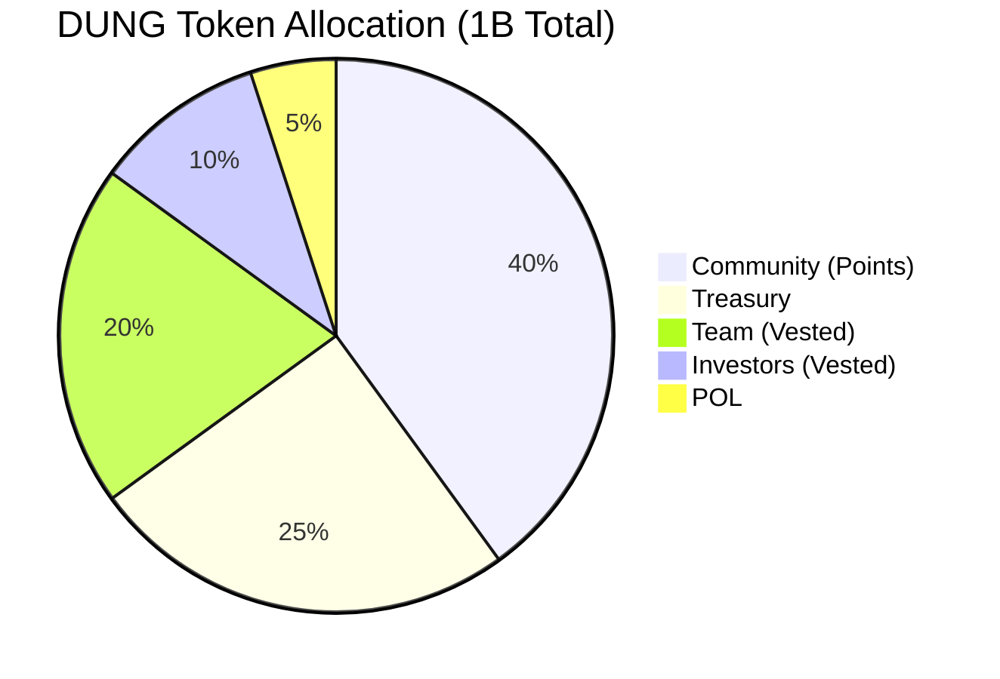
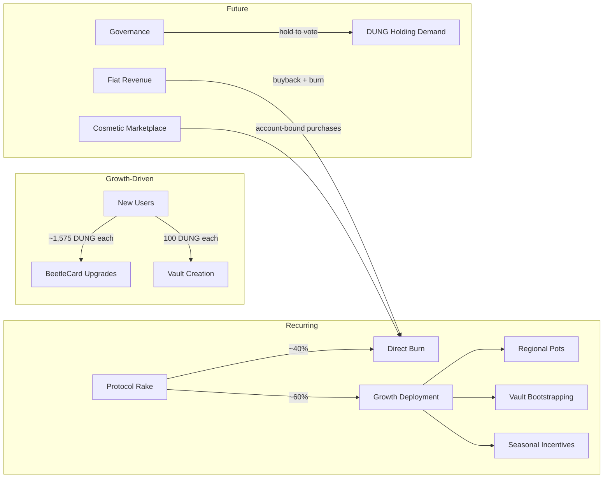

# Boulder Rollers — Formal Economic Model

**Version:** 1.1
**Date:** July 16, 2026
**Status:** HISTORICAL — superseded economic model
**Audience:** Investors, grant evaluators, protocol economists

Current economic authority is [PROTOCOL_TRUTHS.md](PROTOCOL_TRUTHS.md) and [FRESHEST_SPEC.md](FRESHEST_SPEC.md), whose zero-start rule forbids the TGE horizon retained below.

---

## 1. System Overview

Boulder Rollers is a cycling DePIN protocol on Solana that financializes geographic routes. Riders earn tokens through verified physical effort, stake in geographic vaults (climbing segments), and compete on permanent leaderboards.



---

## 2. Token Definitions

### 2.1 CAL (Effort Token)

| Property | Specification |
|----------|---------------|
| Type | SPL Token (Solana) |
| Generation | Minted 1:1 with TSS from verified rides |
| Supply | Uncapped (bounded by human physiology) |
| Transferability | Fully transferable post-TGE |
| Primary use | Staking in vaults for DUNG yield |

**Physiological supply bound:** Maximum sustainable TSS for an elite cyclist is ~1,200/week (professional tour level). A typical serious amateur produces 400-600 TSS/week. CAL inflation is inherently limited by human output.

### 2.2 DUNG (Value Token)

| Property | Specification |
|----------|---------------|
| Type | SPL Token (Solana) |
| Total Supply | 1,000,000,000 (fixed) |
| Decimals | 9 |
| Generation | Minted when vaults accumulate 1000 CAL |
| Primary use | Rewards, governance, BeetleCard upgrades, vault creation |

---

## 3. Formal Token Flow Model

### 3.1 Earning Phase

Let:
- `T` = rider's Training Stress Score for a ride
- `n` = number of vaults crossed during ride
- `reward_FTP` = immutable reward FTP selected for the ride's start time

```
CAL_credited_to_rider = CAL_earned = T
cal_tribute_policy = cal_tribute_segment_tss_v2

For each eligible matched Vault i:
    segment_tss_base_units_i = floor(
        segment_np_duration_s_i * segment_np_milliwatts_i^2
        * 100 * 1_000_000_000
        / (reward_FTP^2 * 1_000_000 * 3_600)
    )

exact_tribute_budget_base_units = sum(segment_tss_base_units_i)
```

The policy version is `cal_tribute_segment_tss_v2`. The rider receives full
attested CAL; Vault tribute is a separate lifetime flow-meter input. NP is
frozen as integer milliwatts with its pause-aware NP duration, and every amount
is floored independently to one CAL base unit. The immutable ride-time reward
FTP supplies the denominator; mutable profile FTP never enters the calculation.
Missing, insufficient, or zero segment power has zero tribute with no gradient
proxy; completion and leaderboard truth remain independent. One fastest
qualifying traversal per ride and Vault supplies the single receipt. Overlapping
eligible climb windows require review, and the sum never exceeds full attested
CAL. Historical plans retain their original formula.

### 3.2 Conversion Phase

Let:
- `r` = CAL:DUNG conversion ratio (governance-adjustable, default 1000)
- `CAL_vault` = total CAL accumulated in a vault

```
DUNG_minted_to_pot = floor(CAL_vault / r)
```

Conversion is instant and continuous — each unit of `r` CAL crossing the threshold mints exactly 1 DUNG to the vault's reward pot.

### 3.3 Distribution Phase (Settlement Week Finalization)

Let:
- `P` = vault pending_rewards (DUNG in pot)
- Distribution vector `D = [0.55, 0.27, 0.03, 0.10, 0.05]`
- `unlock_bps(s)` = the participation unlock percentage expressed in basis points

```
base_stakers        = floor(P × 0.27)
DUNG_local_legend   = floor(P × 0.03)              // rolling stewardship seat
DUNG_treasury       = floor(P × 0.10)
DUNG_pol            = floor(P × 0.05)
base_record_royalty = P - base_stakers - DUNG_local_legend - DUNG_treasury - DUNG_pol
weekly_unlocked     = floor(base_stakers × unlock_bps(s) / 10000)
locked_stakers      = base_stakers - weekly_unlocked
record_royalty      = base_record_royalty + locked_stakers + prior_record_carry
staker_available    = weekly_unlocked + prior_unlocked_staker_dust
carry_stakers       = staker_available - sum(pro_rata_staker_allocations)
```

Where `unlock_bps(s)` is the staker unlock function:

```
s = number of unique stakers
unlock_bps(s) = UNLOCK_CURVE_BPS[min(s, 10)]

UNLOCK_CURVE_BPS = [0, 100, 300, 600, 1100, 1700, 2500, 3500, 5000, 7000, 10000]
```

**Rationale:** Prevents first-mover staker gaming. A single staker captures only 0.27% of the pot. Full staker pool (27%) requires 10+ unique participants.

The curve is applied independently to each Settlement Week's base staker
maximum. `locked_stakers` joins that same week's Record Royalty before rank
allocation. Only already-unlocked pro-rata integer dust may remain in
`carry_stakers`, and that dust is added after the next week's curve rather than
being curved again.

At the policy cutover, an unmarked deployed Vault cannot prove how much of its
legacy `carry_stakers` was locked policy value versus integer dust. The protocol
therefore reclassifies the full legacy value to Record Royalty exactly once,
then writes `STAKER_REMAINDER_POLICY_MARKER`. This loses at most historical
sub-token allocation dust from the staker bucket and prevents a materially
larger locked balance from becoming a retroactive staker entitlement.

### 3.4 Leaderboard Distribution

Top 10 all-time fastest completions share the leaderboard allocation:

```
RANK_PCT = [0.30, 0.20, 0.15, 0.10, 0.08, 0.06, 0.05, 0.03, 0.02, 0.01]

For k entries (k ≤ 10):
    rider_share_i = RANK_PCT[i] / Σ(RANK_PCT[0..k])
```

Positions are permanent until displaced by a faster time. Displacement immediately redirects future rewards.

---

## 4. Sink Mechanics (Deflation)

### 4.1 BeetleCard Upgrade Burns

```
cost(level) = 25 × 2^(level - 1) DUNG    (100% burned)
```

| Level | Cost | Cumulative | Realistic? |
|-------|------|------------|------------|
| 1→2 | 25 | 25 | Yes |
| 2→3 | 50 | 75 | Yes |
| 3→4 | 100 | 175 | Yes |
| 4→5 | 200 | 375 | Yes |
| 5→6 | 400 | 775 | Yes |
| 6→7 | 800 | 1,575 | Achievable |
| 7→8 | 1,600 | 3,175 | Difficult (score threshold ~43 years at median effort) |
| 8→9 | 3,200 | 6,375 | Elite only |
| 9→10 | 6,400 | 12,775 | Nearly unreachable |

**Effective burn per user: ~1,575 DUNG** (L1 through L7 realistic cap).

### 4.2 Vault Creation Burns

Dual-price mechanism:

```
Path A: 100 DUNG (burned)
Path B: 1,000 CAL + $2 USDC

Rational agent chooses:
    if 100 × P_DUNG < $2 → Path A (buy DUNG, burn it)
    if 100 × P_DUNG > $2 → Path B (pay USDC)

Arbitrage-enforced floor: P_DUNG ≥ $0.02
```

### 4.3 Protocol Rake (Recurring)

```
Sources:
    10% of every vault Settlement Week finalization → treasury
    5% of all collected DUNG → treasury
    0.5% of unstaked CAL → burn/POL split

Treasury deployment (governance-adjustable):
    ~40% → direct burn (permanent deflation)
    ~60% → growth deployment (regional pots, vault bootstrapping)
```

### 4.4 Aggregate Burn Rate

```
Monthly burn per rider ≈ BeetleCard_upgrade + vault_creation + rake

    BeetleCard: ~1,575 / 21 months = ~75 DUNG/month (averaged over L1-L7 journey)
    Vault creation: (N_riders / 50) × 100 × 0.5 / N_riders ≈ 1 DUNG/rider/month
    Rake burn: proportional to economic activity

Monthly mint per rider ≈ 0.58 DUNG (at r = 1000:1)

Mint/burn ratio ≈ 0.03%
```

**The system is structurally deflationary.** All burned DUNG draws from the fixed TGE allocation — there is no inflationary minting spiral.

---

## 5. Supply Dynamics

### 5.1 TGE Allocation



| Allocation | Amount | % | Unlock |
|------------|--------|---|--------|
| Community | 400M | 40% | 100% at TGE |
| Treasury | 250M | 25% | Protocol-controlled |
| Team | 200M | 20% | On-chain vesting (TBD cliff + linear) |
| Investors | 100M | 10% | On-chain vesting (TBD cliff + linear) |
| POL | 50M | 5% | Protocol-owned, permanent LP |

### 5.2 Circulating Supply Projection

```
S_circ(t) = S_tge_unlocked + S_minted(t) - S_burned(t)

Where:
    S_tge_unlocked = 400M (community) + vested_team(t) + vested_investor(t)
    S_minted(t) = Σ(monthly_riders × 0.58 × halving_multiplier)
    S_burned(t) = Σ(monthly_riders × ~76 + rake_burns)
```

**36-Month Projections:**

| Scenario | Riders at M36 | Total Minted | Total Burned | Circulating | Deflation |
|----------|---------------|-------------|-------------|-------------|-----------|
| Bear (5K cap) | 5,000 | 9K | 23M | ~477M | 2.3% |
| Base (20K cap) | 20,000 | 49K | 144M | ~356M | 14.4% |
| Bull (50K cap) | 50,000 | 150K | 487M | ~13M | 48.7% |

> **Note:** Bull scenario approaches liquidity crisis. BeetleCard cost parameters are tunable placeholders — the exponential curve naturally self-limits as costs become prohibitive at higher levels.

### 5.3 Halving Schedule

```
EPOCHS_PER_HALVING = 26 (~6 months)
emission_rate(epoch) = base_rate × 2^(-floor(epoch / 26))
```

**Quantitative finding:** Halving has negligible impact on supply dynamics because total minting is <50K DUNG over 36 months against 144M+ burned. The mechanism exists for narrative coherence and as a safeguard at extreme scale.

---

## 6. Demand Model

### 6.1 DUNG Demand Sources



### 6.2 Demand Lifecycle

```
Phase 1 (TGE → Month 12): BeetleCard-dominated
    Primary demand: new users upgrading L1-L5 (~375 DUNG each)
    Secondary: vault creation, early governance

Phase 2 (Month 12 → Month 24): Maturation
    BeetleCard demand tapers (early users reaching L6-L7)
    Rake flywheel becomes meaningful
    Governance demand grows (ratio votes, fee structure)
    Cosmetic marketplace candidate for launch (if 50K+ MAU)

Phase 3 (Month 24+): Steady state
    New user onboarding = primary BeetleCard demand
    Rake burn = primary recurring deflation
    Fiat revenue buybacks = external demand anchor
    System reaches equilibrium if growth stalls (acceptable)
```

### 6.3 Price Floor Mechanics

The dual-price vault lever creates an arbitrage-enforced floor:

```
P_floor = USDC_price / DUNG_vault_cost = $2 / 100 = $0.02/DUNG

Buy pressure at floor = vault_creation_rate × 100 DUNG

At 20K riders: ~1,714 vaults/month × 100 = 171K DUNG/month
    = $3,429/month buy pressure at floor price
```

Weak at small scale but provides theoretical minimum valuation.

---

## 7. Adversarial Robustness Analysis

### 7.1 Sybil Resistance

```
Per-Sybil cost:
    Power meter:        $300 - $1,000
    Cycling computer:   $200 - $500
    Bicycle:            $500 - $5,000
    Physical effort:    10-20 hrs/week (cannot be automated)
    ─────────────────────────────────
    Total:              $1,000 - $6,500 + ongoing labor

Per-Sybil monthly DUNG earned: ~2.4 DUNG

At $0.05/DUNG: $0.12/month per Sybil identity
At $1.00/DUNG: $2.40/month per Sybil identity

ROI: Deeply negative at any plausible FDV
```

**The physical-activity gate is the protocol's strongest security property.** Hardware cost + ongoing human labor makes Sybil attacks economically irrational.

### 7.2 Token Sink Safety (Three Laws)

| Law | Requirement | Boulder Rollers | Status |
|-----|------------|-----------------|--------|
| **No reflexive sinks** | Spending tokens must not create new emission sources | BeetleCard upgrades don't increase earning capacity | PASS |
| **External demand anchor** | At least one sink tied to non-circular demand | Fiat buybacks (future), governance utility | PARTIAL (future) |
| **Voluntary sinks only** | No forced maintenance or mandatory spending | All sinks are optional | PASS |

Derived from analysis of Helium (survived), STEPN (collapsed), Axie Infinity (collapsed), Render (survived), Fortnite (gold standard).

### 7.3 Known Attack Vectors

| Attack | Cost | Reward | ROI | Mitigation |
|--------|------|--------|-----|------------|
| Staker unlock Sybil (10 wallets × min stake) | 1,000 CAL + gas | Unlock full 27% staker pool | Marginal+ at scale | Raise min stake (tunable) |
| Epoch timing (stake before, harvest after) | 0.5% unstake fee | 1 epoch of rewards | Marginal if accrual is batched | Verify continuous accrual |
| KOM farming (hire pro cyclists) | $200-800/attempt | $214/year at $0.05 FDV | Negative | Self-limiting |
| FIT file fabrication | Hardware cost | ~2.4 DUNG/month | Deeply negative | Power data validation |
| CAL wash trading | Gas only | Volume inflation | Zero economic value | No tribute from transfers |

### 7.4 Structural Risk: Over-Deflation

The primary risk is NOT inflation — it is excessive deflation in a bull scenario.

```
At 50K riders, 36 months:
    487M DUNG burned (48.7% of total supply)
    Circulating: ~13M DUNG
    Implications: severe liquidity crisis, AMM depth collapse
```

**Governor mechanisms:**
1. BeetleCard cost curve is exponential — naturally self-limits as levels become prohibitive
2. All cost parameters are governance-adjustable placeholders
3. The rake burn/growth split can shift toward 100% growth if deflation exceeds target
4. At extreme scarcity, vault creation shifts entirely to USDC path (no DUNG burned)

---

## 8. Governance Architecture (Planned)

### 8.1 Adjustable Parameters

| Parameter | Default | Lever Type | Impact |
|-----------|---------|------------|--------|
| CAL:DUNG ratio | 1000:1 | Monetary policy | Controls vault yield attractiveness |
| Rake burn/growth split | 40/60 | Fiscal policy | Deflation vs ecosystem investment |
| BeetleCard cost curve | 25 × 2^(N-1) | Sink calibration | Burn rate at scale |
| Minimum stake | 100 CAL | Security | Sybil resistance threshold |
| Distribution splits | 55/27/3/10/5 | Incentive alignment | Rider vs staker vs protocol balance |
| Vault creation cost | 100 DUNG / $2 USDC | Price floor + barrier | Entry economics |
| Harvest fee | 5% | Revenue | Treasury accumulation rate |
| Unstake fee | 0.5% | Friction | Churn rate + minor burn |

### 8.2 Governance Mechanism (TBD)

```
Voting power: DUNG-weighted (details TBD)
Quorum: TBD
Timelock: TBD (recommend 48-72 hours for parameter changes)
Proposal threshold: TBD
```

> Design pending. Governance gives DUNG holders influence over monetary policy, creating demand to hold beyond spending. Mechanism details to be specified before TGE.

---

## 9. Key Metrics to Monitor

### 9.1 Health Indicators

| Metric | Healthy Range | Warning | Critical |
|--------|--------------|---------|----------|
| Monthly active riders | Growing or stable | -10% MoM | -25% MoM |
| BeetleCard upgrades / MAR | > 0.1 | < 0.1 | < 0.05 |
| Circulating supply | > 100M DUNG | < 100M | < 50M |
| AMM depth (2% slippage) | > $100K | < $50K | < $20K |
| Unique stakers per vault (avg) | > 5 | < 3 | < 2 |
| Vault creation rate | > 10/week | < 5/week | 0 |
| Rake revenue (weekly) | Growing | Flat | Declining |

### 9.2 Equilibrium Conditions

The system reaches natural equilibrium when:

```
New user BeetleCard demand + Rake burns = Net sell pressure

At equilibrium:
    DUNG price stabilizes
    Minting (negligible) ≈ Ongoing burns (rake)
    BeetleCard demand tapers as early users max out
    Growth deployment sustains rider acquisition
```

This is an acceptable steady state — the protocol does not require perpetual growth to survive. The glory loop (KOM competition) sustains rider engagement independent of token economics.

---

## 10. Pre-TGE Milestones

| Priority | Item | Status | Gate |
|----------|------|--------|------|
| P0 | Tier-1 smart contract audit | Not started | Required for institutional participation |
| P0 | On-chain team/investor vesting contracts | Design phase | Required for credibility |
| P0 | Governance mechanism specification | Concept only | Required for governance demand narrative |
| P1 | Parameter sensitivity testing with real data | Modeling complete | Tune before TGE |
| P1 | POL sizing for TGE sell pressure absorption | Not started | 50M DUNG allocated |
| P1 | Perp market listing (Drift/Zeta) | Not started | Unlocks institutional hedging |
| P2 | Cosmetic marketplace design | Shelved | Launch at 50K+ MAU |
| P2 | Regional performance pots | Concept | Funded by rake growth deployment |

---

## Document History

| Date | Version | Changes |
|------|---------|---------|
| 2026-03-04 | 1.0 | Initial formal economic model. Synthesizes quantitative supply modeling, DePIN sink research, adversarial analysis, and game-theoretic evaluation. |

---

**This document formalizes the economic architecture of Boulder Rollers. All parameters marked as governance-adjustable are tunable placeholders — the architecture (token flows, sink mechanics, distribution structure) is the invariant layer.**
